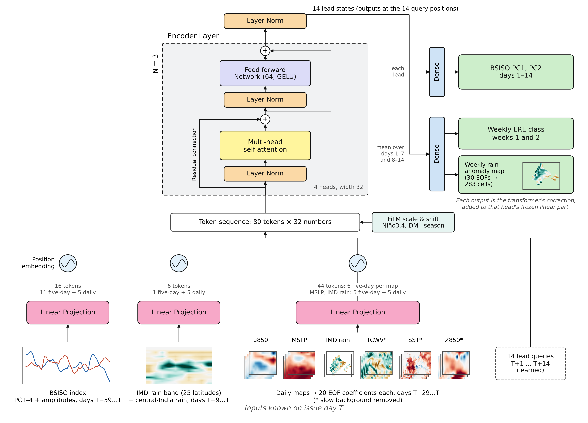

# Transformer-based BSISO Forecast

A transformer that forecasts the boreal summer intraseasonal oscillation (BSISO) and weekly rain anomalies over India up to
two weeks ahead. It is trained on the monsoons of 1960-2013 and tested on 2014-2024 against the ECMWF sub-seasonal reforecasts.

The BSISO is a band of cloud and rain that moves from the equatorial Indian Ocean north-east over India every 30-60 days. It
sets much of the timing of active and break spells of monsoon rain, so a good BSISO forecast carries information about rain
one to three weeks ahead. The earlier analysis behind this link is in [`background/`](background/).

## What the model forecasts

| Output | What exactly | Score |
|---|---|---|
| BSISO | PC1 and PC2 of the Lee et al. (2013) index for each of the next 14 days | bivariate correlation (COR) per lead; a forecast is useful while COR >= 0.5 |
| Rain maps | weekly mean rain anomaly on 283 IMD 1° cells over India, weeks 1 and 2 | anomaly correlation (ACC) of the map |
| Extreme rain (on hold) | weekly chance of no / small-medium / large extreme rain event (ERE) over central India | ranked probability skill score (RPSS) |

The current target is ECMWF: a BSISO correlation of 0.64 at day 14 and a weekly map ACC of 0.58 and 0.37. The ERE head is
still in the code but is not being developed for now.

## The two models

| Model | Folder | Config in `src/profA.py` | Idea |
|---|---|---|---|
| Logistic + Transformer | [`models/logistic_transformer/`](models/logistic_transformer/) | `W3N` | Small linear models (ridge for the BSISO and the maps, logistic regression for ERE) are fitted first and frozen. The transformer learns a correction that is added to their output. |
| Transformer alone | [`models/transformer_only/`](models/transformer_only/) | `TXM` | The same transformer with no linear part. It sees the inputs of the linear models as extra tokens, but not their forecasts. |



## Results on the test monsoons 2014-2024

BSISO correlation by lead, useful days, weekly map ACC and weekly ERE skill. Forecasts are the mean of 10 runs with different seeds.

| Model | Day 1 | Day 5 | Day 10 | Day 14 | Useful days | Map ACC wk 1 | Map ACC wk 2 | ERE RPSS wk 1 | ERE RPSS wk 2 |
|---|---|---|---|---|---|---|---|---|---|
| Logistic + Transformer | 0.963 | 0.690 | 0.510 | 0.444 | 10.5 | 0.425 | 0.229 | 0.188 | 0.076 |
| Linear models alone | 0.971 | 0.678 | 0.477 | 0.409 | 9.2 | 0.425 | 0.225 | 0.193 | 0.075 |
| Transformer alone | 0.855 | 0.656 | 0.495 | 0.404 | 9.6 | 0.370 | 0.207 | 0.180 | 0.110 |
| Persistence | 0.953 | 0.562 | 0.198 | -0.018 | 5.7 | 0.195 | 0.021 | | |
| ECMWF reforecasts | 0.961 | 0.898 | 0.767 | 0.636 | > 14 | 0.579 | 0.367 | 0.192 | 0.106 |

- The linear models carry most of the skill. On top of them the transformer adds 1.3 useful days of BSISO forecast and almost
  nothing for the maps.
- On its own the transformer is weaker at day 1 (0.86 against 0.97) and in week 1 of the maps. It catches up by day 10.
- ECMWF is far ahead from day 3 on. Closing that gap is the aim of the next steps.

Per-lead tables are in each model's `results/` folder.

## Repository layout

```
paths.py                  where the data, processed inputs and Kaggle outputs live (set by environment variables)
requirements.txt
data/                     README: every dataset, its source and how to get it
data_processing/          download and processing scripts: model inputs and the ECMWF benchmark
src/                      the code the Kaggle runs used (data building, linear fits, network, training, all configs)
models/
  logistic_transformer/   model.py (the model), README, Kaggle notebooks with their outputs, scoring scripts, results
  transformer_only/       the same for the transformer alone
  check_equivalence.py    checks that each model.py gives exactly the same network as src/profA.py
figures/                  figures of the inputs, the network and the results, with the scripts that make them
background/               earlier analysis: the BSISO and Indian rain, BSISO against MISO, a summary of the first tests
```

## How to run

1. Get the data listed in [`data/README.md`](data/README.md) and set the folders in [`paths.py`](paths.py)
   (environment variables `BSISO_DATA`, `BSISO_WORK`, `BSISO_RUNS`).
2. Build the model inputs with the scripts in [`data_processing/`](data_processing/).
3. Upload `src/` and the input files as a Kaggle dataset and run the notebooks in `models/*/notebooks/` on a GPU (T4).
   A 10-seed test fit takes about 12 minutes for the Logistic + Transformer and 35 minutes for the transformer alone.
4. Download the Kaggle outputs to `BSISO_RUNS/<ROUND>/out/out/` and score them with `cv_eval.py` and `test_eval.py`
   in each model folder.

Install the Python packages with `pip install -r requirements.txt`.

## Data split and rules

- Training: issue days 31 May to 16 September of 1960-2013 (109 per summer), plus off-season days as BSISO-only samples.
- Choices (variant, epoch) are made in cross-validation over 1981-2013 (5 blocks of years), never on the test years.
- Test: 2014-2024, scored once per model.
- Inputs are only what is known on the issue day: observations and reanalysis. ECMWF forecasts are a benchmark, never an input.

## References

- Lee, J.-Y. et al. (2013). Real-time multivariate indices for the boreal summer intraseasonal oscillation over the Asian summer monsoon region. *Climate Dynamics* 40, 493-509.
- Pai, D. S. et al. (2014). Development of a new high spatial resolution (0.25° x 0.25°) long period (1901-2010) daily gridded rainfall data set over India. *Mausam* 65, 1-18.
- Hersbach, H. et al. (2020). The ERA5 global reanalysis. *Quarterly Journal of the Royal Meteorological Society* 146, 1999-2049.
- Vaswani, A. et al. (2017). Attention is all you need. *Advances in Neural Information Processing Systems* 30.
- Vitart, F. et al. (2017). The Subseasonal to Seasonal (S2S) prediction project database. *Bulletin of the American Meteorological Society* 98, 163-173.
