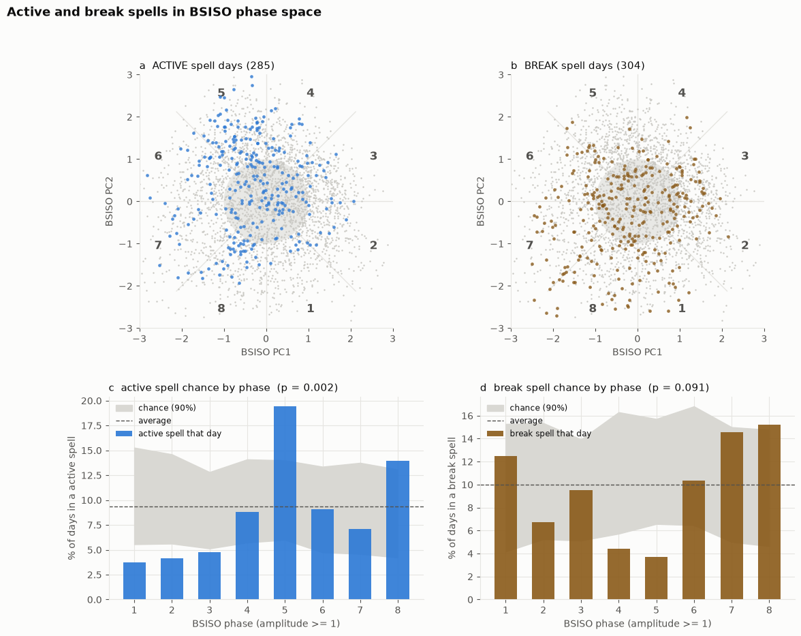
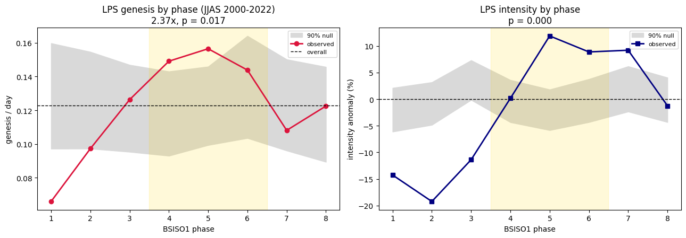
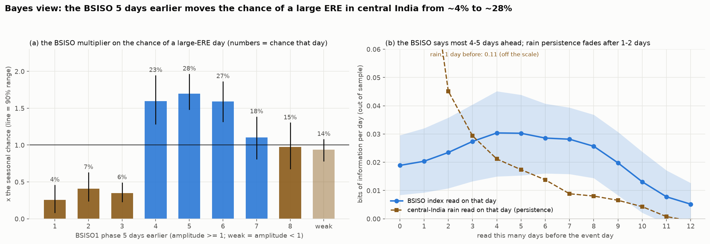
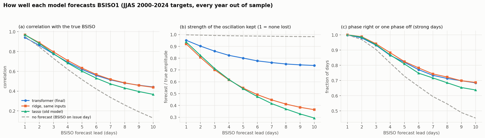
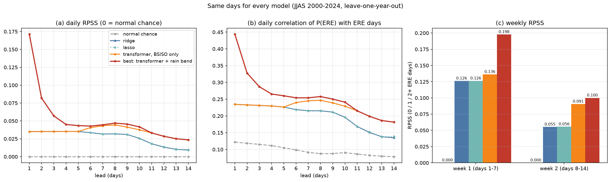

# Background: the BSISO and Indian monsoon rain

Before building the forecast model we checked, in observations, how the BSISO shapes rain over India and whether a BSISO
forecast could carry that information forward. This page summarises those studies. Two of them are kept in full:

| Folder | Content |
|---|---|
| [`BSISO-Rain/`](BSISO-Rain/) | rain, OLR, active/break spells and extreme rain by BSISO phase, following the plots of Dey et al. (2022) |
| [`BSISO_MISO_Comparison/`](BSISO_MISO_Comparison/) | the BSISO index against the rain-based MISO index, for spells and extreme rain |

The other early studies (active spells, low-pressure systems, extreme-rain link, first forecasts, rain band) are summarised
below; their full notebooks are in the git history of this repository. These studies used IMERG rain at 0.25° (2000-2024) and
extreme-rain events of 16 or more connected cells. The forecast models use IMD rain at 1° and smaller events, so the numbers
are not directly comparable.

## 1. The BSISO sets the rhythm of active and break spells

- Active spells over central India are twice as common in BSISO phase 5 as on an average day (19.4% of phase-5 days against
  9.3%). Break spells lean towards phases 7-8, but more weakly.
- The rain band moves north with the phase: the wettest latitude (70-90°E) is near 5°N in phases 1-2 and near 19°N in phases 5-6.
- Today's BSISO already helps forecast a spell a week ahead, but only a little. For active spells 10-15 days ahead, a perfectly
  known BSISO would help seven times more than a statistical BSISO forecast did. A better BSISO forecast is the gap to close.

## 2. Low-pressure systems carry the heavy rain

- The BSISO phase changes how strong the monsoon low-pressure systems are (from 27% below to 15% above average) and, more
  weakly, how often they form (about 30% more near phase 5). The amplitude does not change how often they form.
- The heaviest rain sits close to the storm centres: within 500 km of a centre, 3.8% of the area gets 16% of the heaviest
  rain days.
- Storms help a forecast only for the next few days, so the model does not use a storm catalogue.

## 3. Extreme rain follows the BSISO, most clearly five days later

- The chance of a large extreme-rain day over central India runs from 3.7% in phase 1 to 28.4% in phase 5, against 15.3% on
  average. The Northeast gets its large events in the opposite phases.
- The BSISO says most about the rain about five days ahead. The bigger the event, the tighter the link: 80% of the largest
  events (91+ cells) start in phases 4-6, against 40% by chance.
- A stronger BSISO adds nothing once its phase is known, and even a perfectly known BSISO removes only about 5% of the
  day-to-day uncertainty. Extreme rain stays hard to forecast; the weekly rain map is the more useful target.

## 4. First forecasts: the BSISO alone, then the rain band

- A small transformer forecast the BSISO, and a regression turned it into the daily chance of extreme rain 1-14 days ahead.
  On the 10% of days rated most likely, a large event happened 34-35% of the time, against 15% normally. The transformer was
  not a better BSISO forecaster than ridge regression, but it kept the oscillation's strength.
- Adding the monsoon rain band seen on the forecast day helped a lot in the first week (daily RPSS 0.171 against 0.035 at
  day 1). Beyond a week the skill came only from the BSISO forecast.

## 5. Why the BSISO and not MISO

MISO, the index built from the last 15 days of rain over India, forecasts itself further ahead (13.4 against 6.2 days to an
ACC of 0.5). But it is worse for forecasting extreme rain beyond a few days: it describes the monsoon on the day very well,
while only the BSISO gives warning days ahead. Details in [`BSISO_MISO_Comparison/`](BSISO_MISO_Comparison/).

## What this meant for the model

- The BSISO forecast is the backbone of the model, and the rain forecast is built on it.
- The recent rain band and rain maps are inputs, because they carry the first week.
- The targets became the BSISO itself and weekly rain-anomaly maps; extreme rain stays as a third head, on hold for now.

## Other figures

| File | Shows |
|---|---|
| `figures/ere_phase_maps.png` | where extreme rain falls in each BSISO phase |
| `figures/spell_forecast_skill_by_lead.png` | skill of the spell forecast by lead |
| `figures/extreme_rain_near_lps.png` | share of the heaviest rain near storm centres |
| `figures/first_ere_forecast_skill.png` | skill of the first extreme-rain forecast by lead |
