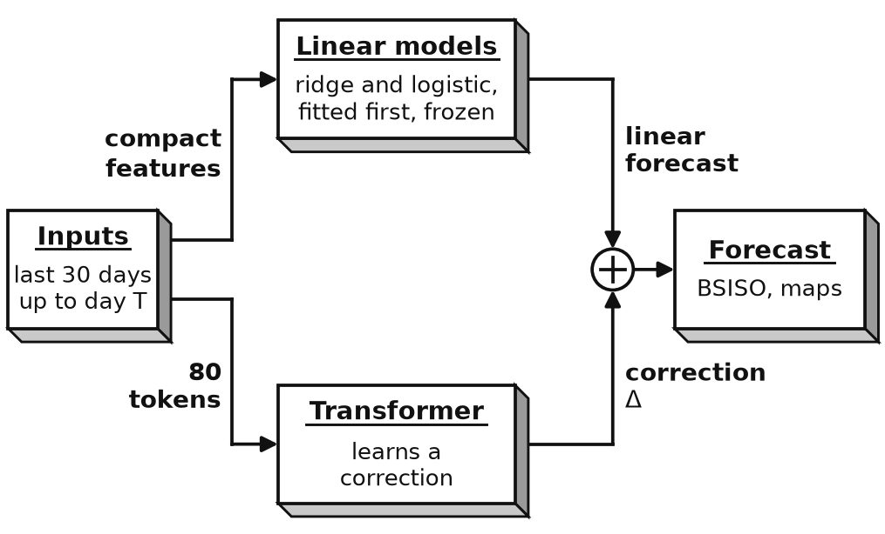

# Logistic + Transformer (config `W3N`)

The main model. Small linear models see the same days as the transformer. They are fitted first, in closed form, and then
frozen. The transformer only learns a correction that is added to their output. Its output layers start at zero, so at
epoch 0 the model is exactly the linear forecast and every later change is the transformer's own contribution.

The name comes from the extreme-rain part, which is a logistic regression. For the BSISO and the maps the same job is done
by ridge regression.



## Outputs

For lead k = 1..14 (days) and week w = 1, 2:

```
BSISO     P_k = P_lin_k + W_B h_k + b_B
maps      m_w = m_loc_w + (c_lin_w + W_R h_w + b_R) V
ERE       l_w = l_norm_w + a.x + dl_w        (two logits: any ERE, large ERE given one)
```

`h_k` is the encoder state of lead query k, `h_w` its mean over the week, and `V` holds the 30 rain-anomaly EOFs of the weekly
IMD maps (283 cells). `P_lin` and `c_lin` are the ridge forecasts, `m_loc` a damped copy of each cell's recent rain, `l_norm`
the normal-chance logit and `a.x` the logistic model.

## The frozen linear models

| Part | Fit | Inputs, all known on issue day T |
|---|---|---|
| BSISO | ridge, per lead | PC1-4 on each of the last 30 days; 20 OLR EOFs at lags 0, 5, ..., 25 days |
| Map cells | ridge, per cell | the cell's rain anomaly on day T and its 3- and 7-day means |
| Map EOFs | ridge | rain EOFs of day T and of the 3-, 7- and 15-day means; PC1-4 at T, T-5, T-10; OLR, u850 and MSLP EOFs; ENSO, IOD, season; the linear BSISO forecast |
| ERE | logistic (Newton steps from the normal chance) | indices of day T (BSISO, rain band, OLR, winds, pressure); rain and MSLP map EOFs; the linear BSISO forecast |

Penalties: 300 for each map cell, 1000 for ERE. In cross-validation every part is refitted inside each fold.

## The transformer

80 tokens of 32 numbers each: 14 learned lead queries plus 66 data tokens. The newest five days of the fast inputs get one
token per day; older days are grouped in five-day blocks.

| Input | Source | Days | Tokens |
|---|---|---|---|
| BSISO index (PC1-4, 2 amplitudes) | Lee et al. (2013); rebuilt from NCEP before 1981 | 60 | 16 (11 blocks + 5 days) |
| Rain band (25 latitudes + central India) | IMD | 10 | 6 (1 + 5) |
| MSLP | ERA5 | 30 | 10 (5 + 5) |
| IMD rain map (283 cells) | IMD | 30 | 10 (5 + 5) |
| 850 hPa zonal wind | ERA5 | 30 | 6 |
| Precipitable water, SST, 850 hPa height | ERA5, slow background removed | 30 | 6 each |
| Lead queries T+1 ... T+14 | learned | | 14 |

Each daily map is reduced to 20 EOF coefficients and then to 12 numbers by one linear layer shared by all days. Niño3.4, the
Dipole Mode Index and the day of the year do not become tokens: they scale and shift all tokens (FiLM).

Encoder: pre-norm, 3 layers, 4 attention heads (8 numbers each), feed-forward width 64 with GELU, final layer norm.
The BSISO head reads each lead state; the map and ERE heads read the week means. Figures of every step are in
[`../../figures/`](../../figures/).

## Training

| Setting | Value |
|---|---|
| Training data | issue days 31 May-16 September of 1960-2013; off-season days (160 per step) as BSISO-only samples |
| Loss | 0.5 L_BSISO + 0.5 L_map + 1.0 L_ERE (normalised MSE of PC1/PC2, MSE of the 30 map EOF weights, cross-entropy of the weekly classes) |
| Optimiser | AdamW, learning rate 1.5e-4 (flat), weight decay 0.05, batch 64 |
| Regularisation | dropout 0.2, whole input groups dropped with chance 0.15, input noise 0.2, inputs shifted back up to 2 days, penalty on the size of the correction (0.25 BSISO, 0.3 ERE logits, 0.25-0.3 weekly heads) |
| Weights | averaged over training steps (EMA, 0.99) |
| Epochs | 12, read at epoch 12 (best BSISO epoch in cross-validation) |
| Test forecast | mean of 10 seeds |

## Results

**Cross-validation 1981-2013** (5 blocks of years, 5 seeds; [`results/cv_scores_W3B2.csv`](results/cv_scores_W3B2.csv)).
Gain of the transformer over epoch 0, with the 90% range from resampling summers:

| Score | Linear models (epoch 0) | Gain at epoch 12 | Better in |
|---|---|---|---|
| BSISO COR, days 8-14 | 0.415 | +0.042 [+0.028, +0.056] | 29 of 33 summers |
| Map ACC week 1 | 0.427 | +0.000 | 18 of 33 |
| Map ACC week 2 | 0.225 | +0.002 | 15 of 33 |
| Weekly ERE RPSS | 0.161 / 0.046 | none (best epoch 1) | |

**Test 2014-2024** ([`results/`](results/)):

| | Day 1 | Day 5 | Day 10 | Day 14 | Useful days | Map ACC wk 1 / 2 | ERE RPSS wk 1 / 2 |
|---|---|---|---|---|---|---|---|
| Logistic + Transformer | 0.963 | 0.690 | 0.510 | 0.444 | 10.5 | 0.425 / 0.229 | 0.188 / 0.076 |
| Linear models alone | 0.971 | 0.678 | 0.477 | 0.409 | 9.2 | 0.425 / 0.225 | 0.193 / 0.075 |
| ECMWF | 0.961 | 0.898 | 0.767 | 0.636 | > 14 | 0.579 / 0.367 | 0.192 / 0.106 |

The gain is real for the BSISO and close to zero for the maps and ERE. Our hypothesis: most of the predictable signal at these
leads is linear and sits in the last few days. A ridge model finds it easily, so the transformer only has to learn what is
left over, and about 60% of that is still linear (a propagation rule that changes with the season).

## Files

| File | What it is |
|---|---|
| `notebooks/W3B2_cross_validation.ipynb` | Kaggle run of the cross-validation (round W3B2), with its printed output |
| `notebooks/W3BF_test_2014_2024.ipynb` | Kaggle run of the final fit on 1960-2013 and the test forecasts (10 seeds), with its printed output |
| `cv_eval.py` | scores the cross-validation by epoch: transformer gain, season bootstrap. `python cv_eval.py W3B2 W3N` |
| `test_eval.py` | scores the test against the linear models, persistence and ECMWF. `python test_eval.py` |
| `results/test_W3BF_bsiso.csv` | test BSISO correlation for every lead and the useful days |
| `results/test_W3BF_weekly.csv` | test map ACC, MSSS and weekly ERE RPSS, with ECMWF and bootstrap ranges |
| `results/test_W3BF_daily_ere.csv` | daily ERE skill of the linear part (days 1-7, 8-14) |
| `results/cv_vs_ecmwf_2005_2013.csv` | our out-of-fold forecasts against ECMWF on 2005-2013 |

The model code is [`../../src/profA.py`](../../src/profA.py) (config `W3N`). The scoring scripts read the Kaggle run records
from `BSISO_RUNS` (see [`../../data/README.md`](../../data/README.md)).
