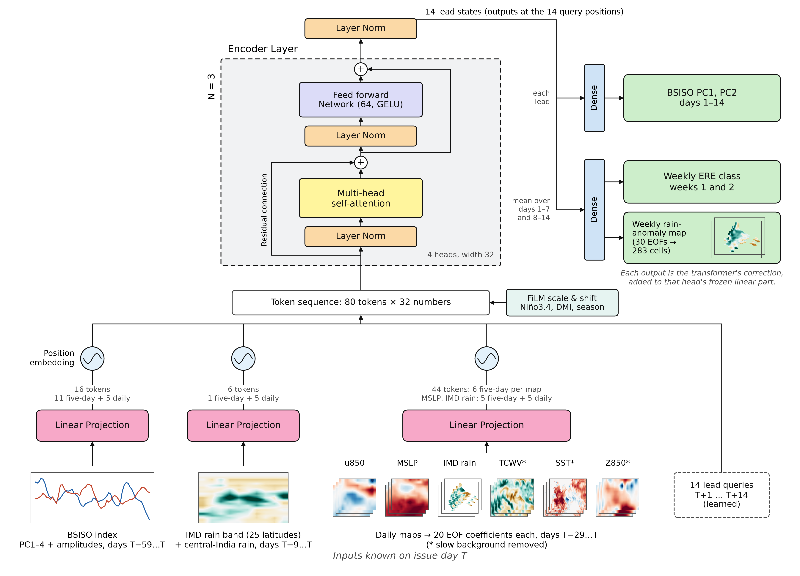
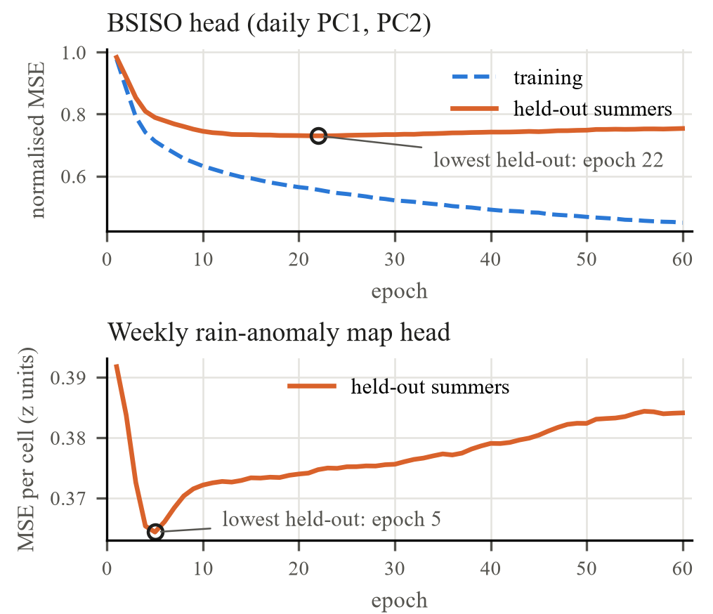
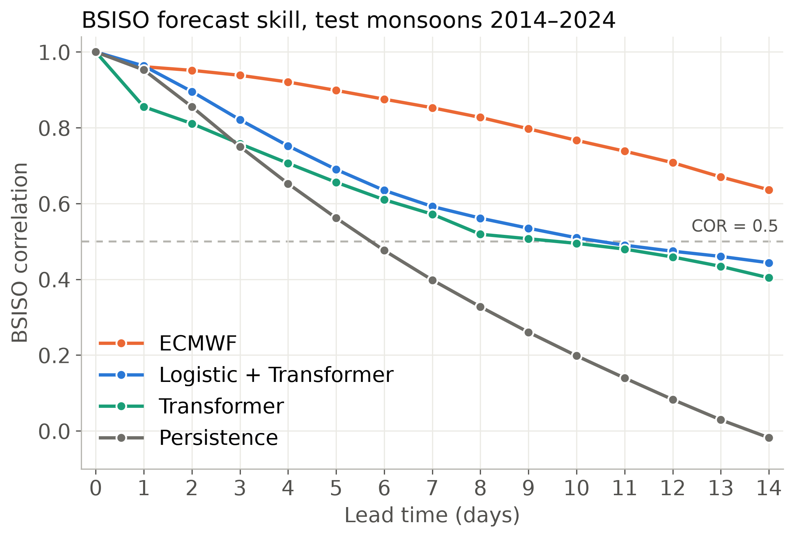

# Transformer alone (config `TXM`)

The same transformer as in the Logistic + Transformer model, with no linear part anywhere. It learns every forecast from
nothing. This model shows what the transformer can do by itself, and where it falls short.

The figure shows the shared transformer. Its note about frozen linear parts applies to the Logistic + Transformer model only:
here the heads give the forecast directly.

## What is different from the Logistic + Transformer model

| | Logistic + Transformer (`W3N`) | Transformer alone (`TXM`) |
|---|---|---|
| Linear models | fitted first, frozen, output added | none |
| Inputs | six maps (MSLP, IMD rain, u850, precipitable water, SST, z850), BSISO, rain band | the same plus OLR and u200, plus one token per input vector of the linear models (their inputs, not their forecasts) |
| Tokens | 80 | 96 (6 for OLR, 6 for u200, 4 linear-input tokens) |
| Weights | 50,092 trained (+ 9,408 frozen linear) | 90,746 |
| Extra head | | a daily rain-map head (283 cells, leads 1-14) as an extra target |
| Learning rate, epochs | 1.5e-4, 12 | 5e-4, 40 |
| Size penalties | yes | none (there is no linear forecast to stay close to) |
| Epoch read | 12 for every head | best per head in cross-validation: BSISO 20, maps 40, ERE 4 |

Everything else is shared: tokens of 32 numbers with one token per day for the newest five days, encoder (3 layers,
4 heads, GELU), FiLM for the slow state, loss weights, AdamW with weight decay 0.05, batch 64, dropout 0.2, EMA of the
weights, off-season BSISO samples and 10 seeds for the test.

`TXM` was the best of the transformer-only variants tried in cross-validation (round TX):

| Config | Change | BSISO COR d8-14 | Useful days | Map ACC wk 1 / 2 |
|---|---|---|---|---|
| W3T | Model P's transformer without its linear part | 0.421 | 6.9 | 0.277 / 0.181 |
| TXA | + OLR and u200 back as inputs | 0.422 | 7.0 | 0.291 / 0.186 |
| TXL | + the linear models' inputs as tokens | 0.447 | 7.7 | 0.317 / 0.206 |
| TXD | TXA + future OLR / u850 EOFs as extra targets | 0.433 | 7.1 | 0.297 / 0.189 |
| TXP | TXA + 10 epochs of pre-training on BSISO and future fields | 0.430 | 6.9 | 0.289 / 0.184 |
| **TXM** | TXL + daily rain-map head | 0.439 | 7.6 | 0.348 / 0.211 |
| TYE, TYW | TXM with a wider field encoding / wider output heads, 60 epochs | 0.453 / 0.456 | 7.8 / 7.9 | 0.349 / 0.347 |
| *linear models alone* | | *0.415* | *7.7* | *0.427 / 0.225* |

Cross-validation 1981-2013, 5 folds x 3 seeds, each head at its best epoch ([`results/cv_scores_TX.csv`](results/cv_scores_TX.csv)).
The 60-epoch run TYW gives the loss curves below.

The training loss keeps falling, but the held-out BSISO loss is lowest at epoch 22 and the held-out map error at epoch 5.
The model starts to learn the training summers by heart early.

## Results on the test monsoons 2014-2024

| | Day 1 | Day 5 | Day 10 | Day 14 | Useful days | Map ACC wk 1 / 2 | ERE RPSS wk 1 / 2 |
|---|---|---|---|---|---|---|---|
| Transformer alone | 0.855 | 0.656 | 0.495 | 0.404 | 9.6 | 0.370 / 0.207 | 0.180 / 0.110 |
| Logistic + Transformer | 0.963 | 0.690 | 0.510 | 0.444 | 10.5 | 0.425 / 0.229 | 0.188 / 0.076 |
| Persistence | 0.953 | 0.562 | 0.198 | -0.018 | 5.7 | 0.195 / 0.021 | |
| ECMWF | 0.961 | 0.898 | 0.767 | 0.636 | > 14 | 0.579 / 0.367 | 0.192 / 0.106 |

- The transformer alone beats persistence from day 3 on and stays useful for 9.6 days, close to the 9.2 days of the linear
  models. On day 1 it is clearly worse (0.86 against 0.97): it does not learn the simple day-to-day rotation of the BSISO as
  precisely as a ridge model does.
- For the maps it stays below the linear models in both weeks.
- In week 2 its ERE skill matches ECMWF (0.110 against 0.106), but only near the chosen epoch. The ERE head is on hold for now.

## Files

| File | What it is |
|---|---|
| `model.py` | **the model itself**: the transformer (tokens, linear-input tokens, encoder, BSISO / weekly / daily map heads), the loss and the training loop |
| `notebooks/TX2_cross_validation.ipynb` | Kaggle run of the cross-validation of TXD, TXP and TXM (round TX2), with its printed output |
| `notebooks/TY1_cross_validation_60_epochs.ipynb` | 60-epoch cross-validation of TYE and TYW (the loss-curve run), with its printed output |
| `notebooks/TXMF_test_2014_2024.ipynb` | Kaggle run of the final fit on 1960-2013 and the test forecasts of TXM (10 seeds), with its printed output |
| `cv_eval.py` | picks the best epoch per head in cross-validation for every variant; uses the scoring code of `../logistic_transformer/cv_eval.py` |
| `test_eval.py` | scores the test of TXM with the epochs fixed in cross-validation, against the other models and ECMWF |
| `results/test_TXM_comparison.csv` | the test comparison table |
| `results/test_transformer_only_TXM.csv` | the test scores of TXM alone |
| `results/test_TXM_bootstrap.csv` | season bootstrap of TXM against the other models |
| `results/cv_scores_TX.csv` | cross-validation table of all transformer-only variants |

`model.py` is a readable copy of the parts of [`../../src/profA.py`](../../src/profA.py) that config `TXM` uses. The Kaggle
runs used `profA.py`; [`../check_equivalence.py`](../check_equivalence.py) checks that both give identical outputs and the
same number of weights. The TX and TY rounds are described in the comments below the `CFGS` dictionary of `profA.py`.
